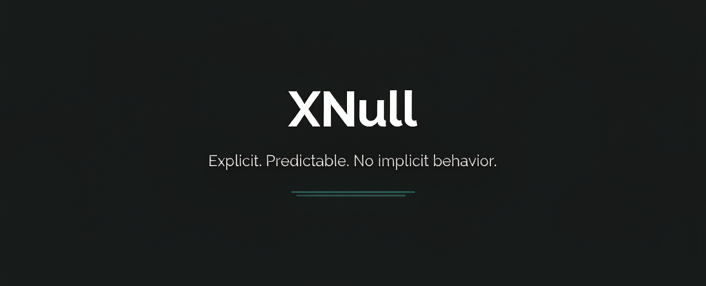

<p align="center">
  
</p>

# XNull

**English** | [简体中文](#xnull中文说明)

**Explicit. Predictable. No implicit behavior.**

XNull is a new programming language built on one axiom: **if a behavior isn't determined by the source text and the spec, it doesn't exist.** No hidden control flow. No implicit memory rules. No "depends on the compiler's mood." Every design decision — including every feature we *rejected*, and exactly why — is written down in an approved, bilingual specification. And this isn't a paper language: an interpreter ships in this repo. Run your first program in 30 seconds.

---

## Core Design Principles

- **Compiler-decided memory management** — Source code never expresses reference strength. The compiler selects the memory management strategy for each object according to its decision table (DET-01), and the runtime executes it. What the language does is always predictable.
- **No accessor pattern** — There are no getters or setters. Properties are properties; behavior is behavior. The two are strictly separated at the syntax level.
- **Composition over inheritance** — Classes do not support override-based inheritance. Polymorphism is achieved exclusively through protocols.
- **Explicit error handling** — Errors are values expressed in the type system. No implicit exception propagation.

Deliberately excluded: overriding, abstract methods, reflection. Every design decision — including the reasons for each rejection — is documented with its rationale in the specifications.

## Run It Today

```x
// examples/hello.x
static Int main() {
    print("hello, XNull")
    print("1 + 2 = " + str(1 + 2))
    return 0
}
```

```
$ go run ./cmd/xnull run examples/hello.x
hello, XNull
1 + 2 = 3
```

A tree-walking interpreter ships with the repository. It currently covers control flow, string interpolation, `try` propagation, and `defer`/`errdefer` (LIFO); unsupported features produce explicit diagnostics, never silent behavior. See `impl/README.md` for the exact scope, and the conformance ledger for item-by-item status.

## Status

| Part | Version | State |
|---|---|---|
| S1 Syntax | v3.3.0 | Approved |
| S2 Object Programming | v3.3.0 | Approved |
| S3 Memory Management | v3.0.0 | Approved |
| S4 Error Handling | v1.0.0 | Approved |
| S5 Runtime Tasks & Concurrency | v1.0.0 | Approved |
| S6 Standard Library (XDK) | v1.1.0 | Approved |
| S7 FFI | v1.0.0 | Approved |
| S8 Project Configuration | v5.2.0 | Approved |
| Compiler (Go) | — | Tree-walking interpreter live (3 examples run); C backend next |

## Design at a Glance

| | XNull | Rust | Go |
|---|---|---|---|
| Memory strategy | Compiler-adjudicated (ARC/GC/stack), invisible in source | Ownership + borrow checker in source | GC only |
| Errors | `Result` values + `try` propagation + `defer`/`errdefer`; no exceptions | `Result` + panics | Values + panics |
| Polymorphism | Protocols only; no overriding | Traits (overriding allowed) | Interfaces |
| Accessors | None, not expressible | Common (getter methods) | None |
| Generics | Monomorphized, no constraints | Monomorphized + traits | Erasure |

## Explicitly Unsupported (by design)

| Feature | Reason |
|---|---|
| Method overriding | "Which method actually ran?" must be answerable from static types; dynamic dispatch exists only via protocols |
| Accessors / properties | Grammar-level separation: fields are data, behavior is verb-named methods |
| Reflection | Breaks the "source + spec determines everything" axiom |
| Exceptions | Errors are values: `Result` + `try`; `throw` is fatal-only and never unwinds |

The complete table with rationale is in [S1 §0.6](./spec/XNull解决方案-第1部分-基础语法-v3.3.0.md).

## Repository Layout

```
├── spec/       # Language specifications (Chinese originals; English translations in spec/en)
├── impl/       # Compiler implementation (Go)
└── examples/   # Runnable examples (hello, Result/try, defer/errdefer)
```

## Roadmap

1. **C backend** — compile one complete program end to end (a tree-walking interpreter already runs the examples)
2. **Incremental completion** — driven by the conformance test ledger
3. **Self-hosting** — the compiler rewritten in XNull

## Contributing — build it with us

XNull started as a one-person design project. The next phases need a team — and the interesting parts are all still ahead.

**We're looking for**

- **Compiler engineers** — the C backend is the next milestone: one file compiles to C, the C compiles to a binary, the binary runs. You'd build it.
- **Standard library (XDK) contributors** — the XDK (S6) decides what "batteries included" means for a language with no exceptions and no reflection: collections, text, IO, concurrency primitives. API design, docs, and reference implementations are all open — the spec (v1.1.0) is the starting point, and your input shapes it.
- **Runtime engineers** — the adjudicated memory runtime (ARC/GC/stack, decided per DET-01), task scheduling, FFI.
- **Design critics** — read the specs and attack the decisions. Every rejection is documented with its rationale; a good counterargument becomes a spec revision.
- **Writers & translators** — tutorials, benchmarks, and translations of the specifications into more languages.

**Contact**: vjsplus@163.com — tell us what you'd like to work on. Design feedback also goes to [GitHub Issues](https://github.com/xnull-clang/xnull/issues); code contributions open as milestones pass the conformance ledger.

## License

This repository uses **dual licensing**, split by content type:

| Content | License |
|---|---|
| Specifications & documents (`spec/`) | [CC BY 4.0](./LICENSE-docs.md) |
| Code (`impl/`, `examples/`) | [Apache-2.0](./LICENSE) |

- You may freely quote, translate, and write tutorials about the specifications with attribution to **XNull Project — github.com/xnull-clang/xnull**.
- The language name and logo are not covered by either license and may not be used to name or promote derivative language projects.

---

# XNull（中文说明）

[English](#xnull) | **简体中文**

**显式 · 可预测 · 拒绝隐式。**

XNull 是一门新编程语言，建立在一个公理上：**凡是源码文本和规范决定不了的行为，就不存在。** 没有隐藏控制流。没有隐式内存规则。没有「看编译器心情」。每个设计决策——包括每一条被拒绝的特性及其确切理由——都写进了审定的双语规范。这也不只是纸面语言：仓库自带解释器，30 秒跑出你的第一个程序。

## 核心设计主张

- **内存管理由编译器决定**：源码不表达引用强度。编译器按判定表（DET-01）为每个对象选择内存管理方式，运行时执行——语言行为始终可预测。
- **无访问器模式**：不存在 getter/setter。属性与行为在语法上严格分离。
- **组合优先于继承**：类不支持继承复写，多态只通过协议（protocol）实现。
- **显式错误处理**：错误是类型系统表达的值，不存在隐式异常传播。

明确不加：覆写、抽象方法、反射。每个设计决策（含拒绝理由）均随规范条款记录在规范文档中。

## 今天就能跑

```x
// examples/hello.x
static Int main() {
    print("hello, XNull")
    print("1 + 2 = " + str(1 + 2))
    return 0
}
```

```
$ go run ./cmd/xnull run examples/hello.x
hello, XNull
1 + 2 = 3
```

仓库自带 tree-walking 解释器。当前覆盖控制流、字符串插值、`try` 传播与 `defer`/`errdefer`（LIFO）；不支持的功能产生显式诊断，绝不静默。精确支持范围见 `impl/README.md`，逐项进度见一致性用例台账。

## 当前状态

| 部分 | 版本 | 状态 |
|---|---|---|
| S1 基础语法 | v3.3.0 | 正式 |
| S2 对象编程 | v3.3.0 | 正式 |
| S3 内存管理 | v3.0.0 | 正式 |
| S4 错误处理 | v1.0.0 | 正式 |
| S5 运行时任务与并发 | v1.0.0 | 正式 |
| S6 标准库 XDK | v1.1.0 | 正式 |
| S7 FFI | v1.0.0 | 正式 |
| S8 工程配置 | v5.2.0 | 正式 |
| 编译器（Go） | — | 解释器已上线（3 个示例可跑）；下一站 C 后端 |

## 设计速览

| | XNull | Rust | Go |
|---|---|---|---|
| 内存策略 | 编译器判定（ARC/GC/栈），源码零注解 | 所有权+借用检查（源码表达） | 仅 GC |
| 错误 | `Result` 值 + `try` 传播 + `defer`/`errdefer`，无异常 | `Result` + panic | 值 + panic |
| 多态 | 只走协议，禁止覆写 | trait（可覆写） | 接口 |
| 访问器 | 语法层面不存在 | 常见（getter 方法） | 无 |
| 泛型 | 单态化、无约束 | 单态化 + trait | 擦除 |

## 明确不加（设计如此）

| 特性 | 理由 |
|---|---|
| 方法覆写 | 「这个方法实际执行的是谁」必须看静态类型就能回答；动态分派只存在于协议 |
| 访问器 / 自定义属性 | 语法级分离：字段是数据，行为是动词命名的方法 |
| 反射 | 破坏「源码 + 规范决定一切」公理 |
| 异常 | 错误是值：`Result` + `try`；`throw` 仅致命 panic，不展开栈 |

完整表格及理由见 [S1 §0.6](./spec/XNull解决方案-第1部分-基础语法-v3.3.0.md)。

## 仓库结构

```
├── spec/       # 语言规范（中文母本；英译见 spec/en）
├── impl/       # 编译器实现（Go）
└── examples/   # 可运行示例（hello、Result/try、defer/errdefer）
```

## 路线图

1. **C 后端**：编译跑通第一个完整程序（tree-walking 解释器已可运行示例）
2. **增量补齐**：按一致性用例台账推进
3. **自举**：编译器改用 XNull 编写

## 参与 —— 一起造 XNull

XNull 从个人设计项目起步，下一阶段需要团队——而最有意思的部分还在前面。

**正在招募**

- **编译器工程师**——下一里程碑是 C 后端：一个文件编译成 C，C 编译成二进制，二进制跑出结果。来把它造出来。
- **标准库（XDK）贡献者**——XDK（S6）决定一门无异常、无反射的语言里「开箱即用」意味着什么：集合、文本、IO、并发原语。API 设计、文档、参考实现全面开放——规范（v1.1.0）只是起点，你的输入直接塑造它。
- **运行时工程师**——判定式内存运行时（ARC/GC/栈，按 DET-01 判定）、任务调度、FFI。
- **设计批评者**——读规范、攻击决策。每条拒绝都写明理由；一个好的反驳会变成一次规范修订。
- **写作者与译者**——教程、基准测试、规范的多语言翻译。

**联系**：vjsplus@163.com，说明你想参与的方向。设计反馈也可通过 [GitHub Issue](https://github.com/xnull-clang/xnull/issues) 提交；代码贡献随里程碑通过一致性台账逐步开放。

## 许可证

本仓库采用**双许可证**，按内容类型划分：

| 内容 | 许可证 |
|---|---|
| 规范与文档（`spec/`） | [CC BY 4.0](./LICENSE-docs.md) |
| 代码（`impl/`、`examples/`） | [Apache-2.0](./LICENSE) |

- 规范可自由引用、翻译、撰写教程，但须署名 **XNull Project — github.com/xnull-clang/xnull**。
- 语言名称与 Logo 不在上述许可范围内，不得用于命名或推广衍生语言项目。
