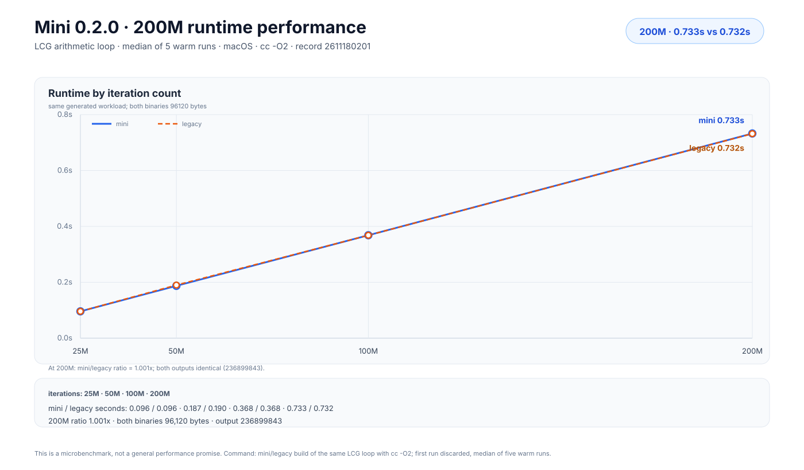

<p align="center">
  
</p>

# XNull

**English** | [简体中文](README/README.zh-CN.md) | [繁體中文](README/README.zh-TW.md) | [Русский](README/README.ru.md) | [العربية](README/README.ar.md) | [Italiano](README/README.it.md) | [Deutsch](README/README.de.md)

**Write the code. Skip the ceremony.**

No lifetimes. No ownership annotations. No `@Override`. No `try/catch`. No getters or setters. No reflection.

XNull is a new programming language where the compiler chooses stack, ARC, or GC for each object using a decision table written into the specification. You write the data and the behavior; the runtime executes the choice. The result is memory management without ownership annotations — and without hidden compiler magic.

Errors are values. Polymorphism is protocols. Fields are fields. The specification records every decision, including every rejected feature and why.

```x
class Counter {
    Int n = 0

    Int add(Int v) {
        self.n = self.n + v
        return self.n
    }
}

static Int main() {
    Counter c = new Counter()
    print(c.add(2))
    return 0
}
```

| You stop writing | XNull gives you |
| --- | --- |
| `Arc<Mutex<T>>`, lifetimes | compiler-decided memory (stack / ARC / GC) |
| `getX()` / `setX()` | direct fields |
| `extends` + `@Override` | protocols |
| `try/catch` | `Result<T,E>` + `try` |
| reflection | not expressible |

## Why XNull

- **Compiler-decided memory management.** Source code never expresses reference strength. The compiler selects stack, ARC, or GC for each object using the DET-01 decision table; the runtime executes the decision.
- **No accessor pattern.** Fields are data; behavior is verb-named methods. Getters and setters are not expressible.
- **Composition over inheritance.** Classes do not support override-based inheritance. Polymorphism is expressed through protocols only.
- **Errors are values.** `Result<T,E>`, `try`, `defer`/`errdefer`. No exceptions, no implicit unwinding.
- **No reflection.** If the source and the specification cannot determine it, it is not part of the language.
- **Every decision is documented.** The specification records what XNull supports, what it rejects, and why. Chinese originals with English translations; more translations are welcome.

## Abstraction profile

XNull does not aim for maximum abstraction. It aims for **bounded abstraction**: hide mechanism, keep structure, and admit only abstractions that can be decided from source + specification.

| Dimension | Level | Notes |
| --- | --- | --- |
| Memory automation | Very high | The compiler chooses stack / ARC / GC via DET-01; source never states lifetimes or reference strength |
| Memory control | Low | No custom allocators or real-time policies; the policy is a closed decision table in the spec |
| Error handling | High | `Result<T,E>` + `try` + `defer`/`errdefer`; no exceptions or implicit unwinding |
| Data modeling | High | Classes, structs, enums, protocols, generics; value and reference semantics separated |
| Behavioral polymorphism | Medium-high | Protocols + composition; no override-based inheritance, no operator overloading |
| Type abstraction | Medium | Generics, protocols, optionals, `Result`; no type classes, higher-kinded types, or dependent types |
| Metaprogramming / reflection | Very low | No reflection, macros, or runtime type construction; framework magic lives outside the language |
| Modular composition | Medium-high | Packages, imports, XDK; composition over inheritance |
| Concurrency | High in design, early in implementation | Tasks, contexts, channels are specified; XDK concurrency packages are still being filled in |
| Syntax / DSLs | Low | No macros or operator overloading; APIs rely on named methods |

### Where the abstraction is strong

- **Memory abstraction is a decision table, not compiler magic.** Source never states reference strength; DET-01 records the choice as checkable rules. Predictable, but closed.
- **Errors are values.** `Result` + `try` put failure paths in the type system; `defer`/`errdefer` make cleanup visible.
- **Composition over inheritance.** Protocols express polymorphism and avoid fragile base classes; fields are data, not getters/setters.
- **Data and behavior are separate.** Direct modeling for compiler IR, ASTs, DTOs, configuration, and other structure-first domains.
- **No reflection means no invisible contracts.** Serialization, dependency injection, and ORMs cannot scan fields at runtime; they need explicit contracts or external generation.

### Where the abstraction tops out

- **Metaprogramming is nearly absent.** No reflection, macros, or runtime type construction; generic frameworks, plugins, ORMs, and DI are limited. This is XNull's biggest abstraction gap.
- **No override-based inheritance.** Fragile base classes are gone, but the "stable skeleton + variable subclass" template-method pattern is unnatural; protocols + composition are the substitute.
- **Protocol evolution is costly.** Adding a method affects every implementor; whether default/extension methods belong in the language must be settled by the spec.
- **No accessors.** A field cannot silently evolve into validation, lazy computation, or a different representation; invariants rely on constructors and methods, and direct assignment can bypass them.
- **Type abstraction stops at generics.** `List<T>`, `Map<K,V>`, `Result<T,E>` exist, but there are no type classes, associated types, or higher-kinded types; "any addable type" needs protocols or per-type code.
- **The memory policy is not extensible.** Enough for compilers, CLIs, services, and data pipelines; not enough for real-time systems, embedded work, or custom allocators.
- **Data-enum destructuring is a key ceiling.** Without pattern matching/binding, AST/IR algebraic data types degrade to `switch` + field access.

### Is XNull "designable"?

| Domain | Designability |
| --- | --- |
| Compilers, toolchains, CLIs | High: data modeling, errors, composition, and predictability all fit |
| Services, data pipelines | High: explicit errors, protocols, and concurrency abstractions are sufficient |
| Long-lived business systems | Medium-high: no override-based inheritance/reflection reduces surprises, but field and protocol evolution have costs |
| Frameworks, plugins, ORMs, DI | Low: without reflection/macros, much of the "magic" cannot be expressed |
| Math DSLs, query DSLs | Low: no operator overloading or macros |
| Real-time, embedded, custom memory | Medium-low: the memory policy is closed and manual control is limited |

### Why "more abstraction" does not automatically mean "more designable"

"More abstraction means more designability" misses one variable: **whether the cost of the abstraction is visible**.

- Java's inheritance/reflection expands the framework design space, but brings fragile base classes, runtime magic, and unpredictable performance.
- Haskell's type classes and higher-order abstractions are extremely expressive, but the learning curve and performance-reasoning cost are high.
- Go has very little abstraction, yet it is very stable for services and toolchains.

XNull's choice is: **trade constraints for predictability**. It is not "the language with the strongest abstraction"; it is "one of the languages with the clearest abstraction boundary."

> XNull's abstraction level: medium-high in semantics, medium in types, very low in metaprogramming; high automation, low manual control.

More precisely: **XNull's abstraction is not "less"; it is narrower and deeper.** It goes deep in its chosen domains (memory, errors, composition) and deliberately gives up breadth in the meta and dynamic layers.

It is not designed for infinite design space, but for designs that are decidable, reasoned about, and maintained over time.

### Abstraction compared with other languages

> More abstraction is not automatically better; the table lists each language's **abstraction focus** and **typical costs**. Order: constrained (XNull, Go) → OO/framework (Java, Dart, Swift) → dynamic/metaprogramming (PHP, JavaScript, Python) → type-level/zero-cost (Rust).

| Language | Abstraction focus | Strengths | Costs / limits | Fits best |
| --- | --- | --- | --- | --- |
| **XNull** | Bounded abstraction: compiler-decided memory, protocols for polymorphism, errors as values | Predictable, low magic, explicit; direct modeling for compilers, toolchains, and services | Almost no metaprogramming; no override-based inheritance or accessors; protocol/field evolution has costs; small ecosystem | Compilers, toolchains, CLIs, data pipelines, long-lived explicit systems |
| **Go** | Minimal abstraction: interfaces, goroutines, GC, explicit errors | Simple, fast to compile, easy to deploy; very stable for services and toolchains | Lower expressive ceiling; verbose error handling; weak type-level abstraction; generics arrived late | Services, CLIs, infrastructure, team collaboration |
| **Java** | Classic OO + framework abstraction: inheritance, interfaces, reflection, annotations, generics | Mature ecosystem and frameworks; strong modeling and tooling for large systems | Verbose; fragile base classes; reflection/annotations bring runtime magic; type erasure; startup/memory overhead | Enterprise applications, Android, large backends, framework ecosystems |
| **Dart** | OO + null safety + async: classes, mixins, generics, async/await, isolates | Great for UI/Flutter; sound null safety; consistent tooling; easy for Java/JS developers | Ecosystem centered on Flutter; weak metaprogramming; single vendor; AOT/VM constraints | Flutter/cross-platform UI, client apps, lightweight services |
| **Swift** | Protocol-oriented + type safety: protocols, value types, generics, optionals, property wrappers/macros | Balanced safety and expressiveness; strong value semantics/protocol extensions; good performance | Apple-centric; compile time/complexity; weaker cross-platform toolchain | iOS/macOS apps, UI, performance-sensitive type-safe code |
| **PHP** | Dynamic + gradual typing: dynamic types, traits, magic methods, incremental typing | Fast web development; huge deployment/hosting ecosystem; low barrier to entry | Historical baggage/inconsistent APIs; dynamic typing pitfalls; lower abstraction ceiling; large projects need discipline | Web backends, content sites, rapid delivery |
| **JavaScript** | Dynamic + prototype/metaprogramming: prototypes, closures, Proxy/Reflect, async | Ubiquitous; natural event-driven/async code; largest ecosystem | Dynamic typing/coercion pitfalls; framework churn; runtime magic; large projects need TS/discipline | Web frontends, Node services, cross-platform scripts, event-driven UI |
| **Python** | Dynamic + duck typing/metaprogramming: decorators, metaclasses, protocols, typing | Fast prototyping; expressive; rich libraries; excellent glue code | Runtime performance; type errors surface late; packaging/versioning; large-scale refactoring is hard | Data/scripting/AI, rapid prototypes, glue layers, automation |
| **Rust** | Type-level + zero-cost abstraction: traits, generics, ownership/lifetimes, macros, pattern matching | Memory safety; zero-cost abstractions; strong type-level modeling; top performance | Steep learning curve; borrow-checker friction; slow compiles; slower prototyping; high complexity | Systems programming, infrastructure, performance-sensitive/high-reliability services |

## Quick start

```sh
# from the repository root
./src/cli/xnull --bootstrap run src/examples/hello.x
```

```text
hello, XNull
1 + 2 = 3
```

The CLI supports three engines:

```sh
./src/cli/xnull --bootstrap --engine=legacy run src/examples/hello.x
./src/cli/xnull --bootstrap --engine=mini   run src/examples/hello.x
./src/cli/xnull --bootstrap --engine=auto   run src/examples/hello.x
```

- `mini` — the new minimal compiler and the default engine since `mini 0.2.0` / M9-CUT. It can compile itself and has passed the mini1/mini2 fixed-point check.
- `legacy` — the frozen native C toolchain and oracle; retained and explicitly selectable.
- `auto` — prefers `mini` when it explicitly supports the program, otherwise falls back to `legacy`.

The default switched to `mini` on 2026-11-18 after M9-PAR passed and M9-CUT was approved. `legacy` remains available via `--engine=legacy` or `XNULL_ENGINE=legacy`.

No Go is required for the bootstrap path. `src/bootstrap/build.sh` builds the native parser and compiler with a C compiler.

## Mini 0.2.0 milestone

The first complete **language source → mini compiler → C → executable** milestone is
recorded in [`src/mini/MILESTONES.md`](src/mini/MILESTONES.md). The acceptance curve
and C-emission performance curve are in:

[`docs/assets/mini-m9cut-20261118.svg`](docs/assets/mini-m9cut-20261118.svg)



The recorded signature `2611180201` is stored verbatim in
[`src/mini/GENESIS`](src/mini/GENESIS) and as the static runtime constant
`xn_mini_genesis` in `src/runtime/rt.c`. It is never read by any logic and is
not used for language behavior or feature decisions.

## Repository layout

```text
assets/               logo and project assets
docs/                 architecture, language, and design documents
README/               translated README files
ide/                  VS Code extension and web IDE
src/                  development tree
  build/              project, dependency, resource, and reactor model
  cli/xnull           unified CLI
  compiler/           legacy compiler
  mini/               self-hosting minimal compiler
  runtime/            C runtime sources and headers
  xdk/                XDK sources
  bindings/           typed FFI contracts (.xfb)
  ffi/                raw FFI bridges (.xfb)
  bootstrap/          native xparser and xn-s4
  toolchain/          build and packaging scripts
  xnfmt/              formatter
  examples/           runnable examples

xdk/                  XDK delivery package
  lib/xdk/            XDK package sources
  runtime/            C runtime sources and headers
  bindings/xdk/       XDK FFI contracts
  ffi/                raw FFI bridges
  install.sh          POSIX sh installer
```

Modify `src/`; `xdk/` is the delivery copy. After changing `src/xdk/`, sync it to `xdk/lib/xdk/`.

## Development

`src/` is the development tree; `xdk/` is the delivery copy. After changing `src/xdk/`, sync it to `xdk/lib/xdk/`.

The CLI entry point and the `mini` / `legacy` / `auto` engines are described in Quick start. The mini compiler milestones are in `src/mini/MILESTONES.md` and `src/mini/PLAN.md`.

### Install XDK

```sh
cd xdk
./install.sh --prefix "$HOME/.local"
```

This installs:

```text
<prefix>/share/xnull/xdk
<prefix>/share/xnull/runtime
<prefix>/share/xnull/bindings
<prefix>/share/xnull/ffi
```

For packaging, use `DESTDIR`:

```sh
DESTDIR=/tmp/xdk-pkg ./install.sh --prefix /usr/local
```

## Status

| Area | Status |
| --- | --- |
| Specifications S1–S5, S7–S8 | Approved |
| XDK catalog S6 | v3.0.0 draft; T0 core first |
| Native C toolchain | Live for the current core scenarios |
| Minimal compiler | Core language + basic classes; broader coverage in progress |
| End-to-end scenarios | hello, classes, `import xdk.errors` pass; more in progress |
| Self-hosting | Planned |

## Explicitly unsupported (by design)

| Feature | Reason |
| --- | --- |
| Method overriding | “Which method actually ran?” must be answerable from static types; dynamic dispatch exists only through protocols |
| Accessors / properties | Grammar-level separation: fields are data, behavior is verb-named methods |
| Reflection | Breaks the “source + spec determines everything” axiom |
| Exceptions | Errors are values: `Result` + `try`; `throw` is fatal-only and never unwinds |

## Roadmap

1. Native C backend: one file compiles to C, the C compiles to a binary, the binary runs.
2. Incremental completion driven by executable scenarios, not feature checklists.
3. Self-hosting: the compiler rewritten in XNull.

## Angel investment

XNull is looking for a small angel round or non-dilutive support to fund 12–18 months of focused work on the compiler, self-hosting, runtime, and XDK. The goal is narrow: make the existing toolchain correct, fast, and usable before expanding the language.

If you are interested, contact **vjsplus@163.com** with the subject `XNull Angel`. Terms are discussed privately.

> This section is informational only and does not constitute an offer to sell or a solicitation of an offer to buy any securities.

## Sponsorship

If XNull is useful to you, small contributions are welcome — every bit helps.

WeChat Pay (mainland China):


> Sponsorship is voluntary, is not an investment, and carries no promised return.

## Contributing

XNull started as a one-person design project. The next phase needs compiler engineers, runtime engineers, XDK/API designers, design critics, writers, and translators. If you think a decision is wrong, bring a counterexample; a good argument becomes a specification revision.

Contact: vjsplus@163.com · [GitHub Issues](https://github.com/xnull-clang/xnull/issues)

## License

Code (`src/`, `xdk/`, `src/examples/`) is licensed under Apache-2.0; see [LICENSE](LICENSE). Specifications and documentation (`docs/`, `README*.md`) are licensed under CC BY 4.0; see [LICENSE-docs.md](LICENSE-docs.md). The XNull name and logo are not covered by either license.
