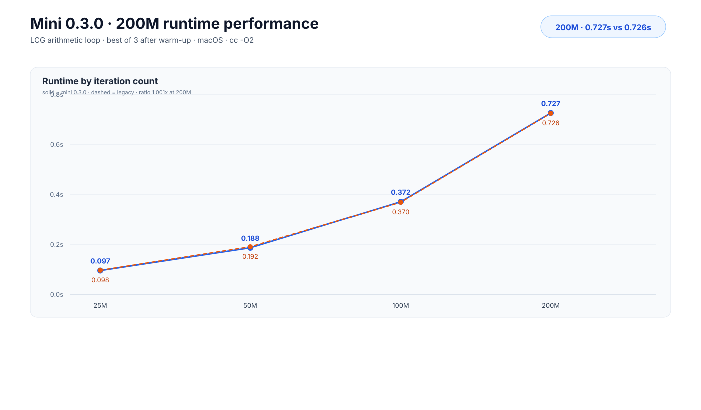
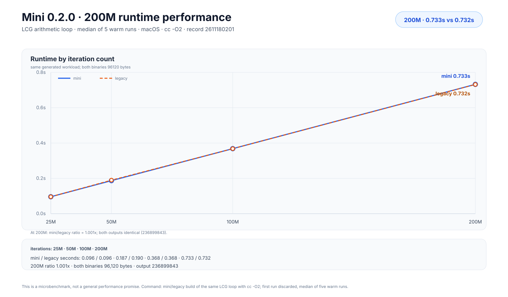

<p align="center">
  
</p>

# XNull

[English](../README.md) | **简体中文** | [繁體中文](README.zh-TW.md) | [Русский](README.ru.md) | [العربية](README.ar.md) | [Italiano](README.it.md) | [Deutsch](README.de.md)

**写代码，别写仪式。**

没有生命周期标注。没有所有权注解。没有 `@Override`。没有 `try/catch`。没有 getter/setter。没有反射。

XNull 是一门新编程语言：编译器按规范里的判定表，为每个对象选择栈、ARC 或 GC；运行时执行这个选择。你只写数据和行为，不需要在类型上标注内存策略，也不需要猜编译器做了什么。

错误是值，多态是协议，字段就是字段。规范记录每一个决定，包括每一个被拒绝的特性和理由。

```x
class Counter {
    Int n = 0

    Int add(Int v) {
        self.n = self.n + v
        return self.n
    }
}

static Int main() {
    Counter c = new Counter()
    print(c.add(2))
    return 0
}
```

| 你不再写 | XNull 提供 |
| --- | --- |
| `Arc<Mutex<T>>`、生命周期 | 编译器决定内存（栈 / ARC / GC） |
| `getX()` / `setX()` | 直接字段 |
| `extends` + `@Override` | 协议 |
| `try/catch` | `Result<T,E>` + `try` |
| 反射 | 语法上不存在 |

## 为什么是 XNull

- **内存管理由编译器决定。** 源码不表达引用强度。编译器按 DET-01 判定表为每个对象选择栈、ARC 或 GC；运行时执行判定。
- **没有访问器模式。** 字段是数据，行为是动词命名的方法；getter/setter 在语法上不存在。
- **组合优先于继承。** 类不支持覆写式继承；多态只通过协议表达。
- **错误是值。** `Result<T,E>`、`try`、`defer`/`errdefer`；没有异常，也没有隐式展开。
- **没有反射。** 源码和规范决定不了的东西，就不属于语言。
- **每个决定都有记录。** 规范写清 XNull 支持什么、拒绝什么、为什么。中文母本 + 英文翻译；欢迎更多语言版本。

## 抽象画像

XNull 的目标不是“抽象最大化”，而是**有边界的抽象**：隐藏机制，保留结构；抽象必须能由“源码 + 规范”判定。

| 维度 | 程度 | 说明 |
| --- | --- | --- |
| 内存自动化 | 很高 | 编译器按 DET-01 选栈 / ARC / GC；源码不写生命周期或引用强度 |
| 内存可控性 | 低 | 不提供自定义分配器/实时策略；策略是规范中的封闭判定表 |
| 错误处理 | 高 | `Result<T,E>` + `try` + `defer`/`errdefer`；没有异常和隐式展开 |
| 数据建模 | 较高 | 类、结构体、枚举、协议、泛型；值语义与引用语义分开 |
| 行为多态 | 中高 | 协议 + 组合；没有覆写式继承、override、运算符重载 |
| 类型抽象 | 中等 | 泛型、协议、可空、`Result`；没有类型类、高阶类型、依赖类型 |
| 元编程 / 反射 | 很低 | 没有反射、宏、运行时类型构造；框架式魔法不在语言内 |
| 模块组合 | 中高 | package / import / XDK；组合优先于继承 |
| 并发 | 设计面高，实现面早期 | task / context / channel 在规范中有位置，XDK 并发包仍在补齐 |
| 语法 / DSL | 低 | 没有宏和运算符重载；API 依赖命名方法 |

### 抽象强在哪

- **内存抽象是“决策表”，不是编译器魔法。** 源码不表达引用强度，DET-01 把选择写成可检查的规则；可预测，但封闭。
- **错误是值。** `Result` + `try` 让失败路径进入类型系统；`defer`/`errdefer` 让清理可见。
- **组合优先于继承。** 协议表达多态，避免 fragile base class；没有 getter/setter，字段就是数据。
- **数据与行为分离。** 对编译器 IR、AST、DTO、配置这类“结构明确”的领域，建模直接。
- **没有反射，就没有看不见的约定。** 序列化、依赖注入、ORM 不能靠运行时扫字段；必须显式写契约或外部生成。

### 抽象天花板在哪

- **元编程几乎为零。** 没有反射、宏、运行时类型构造；通用框架、插件、ORM、DI 的表达力受限。这是 XNull 最大的抽象短板。
- **没有覆写式继承。** 避免了脆弱基类，但“稳定骨架 + 可变子类”的模板方法模式不自然；只能用协议 + 组合替代。
- **协议演化成本高。** 给协议加方法会影响所有实现者；默认方法/扩展方法是否进入语言，需要规范明确。
- **没有访问器。** 字段不能悄悄演化成校验、懒计算或不同存储；不变量靠构造函数和方法维护，直接赋值可以绕过。
- **类型抽象止于泛型。** 有 `List<T>`、`Map<K,V>`、`Result<T,E>`，但没有类型类/关联类型/高阶类型；“任意可相加类型”这类抽象要用协议模拟或逐类型实现。
- **内存策略不可扩展。** 对编译器、CLI、服务、数据处理足够；对实时系统、嵌入式、自定义分配器不够。
- **数据枚举的解构能力是上限关键。** 如果没有模式匹配/解构绑定，AST/IR 这类代数数据类型会退化成 `switch` + 字段访问。

### “可设计性”算高还是低

| 领域 | 可设计性 |
| --- | --- |
| 编译器、工具链、CLI | 高：数据建模、错误处理、组合、可预测性都合适 |
| 服务端、数据管道 | 较高：显式错误、协议、并发抽象够用 |
| 长期演化的业务系统 | 中高：无覆写式继承/无反射减少意外，但字段与协议演化有成本 |
| 框架、插件、ORM、DI | 偏低：没有反射/宏，很多“魔法”写不出来 |
| 数学 DSL、查询 DSL | 低：没有运算符重载/宏 |
| 实时、嵌入式、自定义内存 | 中低：内存策略封闭，控制力不足 |

### 为什么“抽象越强”不等于“越可设计”

“抽象越强，可设计性越大”这句话，漏了一个关键变量：**抽象的成本是否可见**。

- Java 的继承/反射让框架设计空间很大，但带来 fragile base class、运行时魔法、性能不可预测。
- Haskell 的类型类/高阶抽象让表达力极强，但学习曲线和性能推理成本高。
- Go 的抽象很少，但在服务端/工具链领域设计得很稳。

XNull 的选择是：**用约束换可预测性**。它不是“抽象能力最强的语言”，而是“抽象边界最清楚的语言之一”。

> XNull 的抽象程度：语义层中高，类型层中等，元层很低；自动化高，控制力低。

更准确的说法是：**XNull 的抽象不是“更少”，而是“更窄、更深”。** 它在选定的领域里抽象得很深（内存、错误、组合），主动放弃元层和动态层的宽度。

它不是为“无限设计空间”设计的，而是为“可判定、可推理、可长期维护的设计”设计的。

### 与其他语言的抽象对比

> 抽象强弱不是优劣；下表列的是“抽象重心”和“典型代价”。顺序按抽象风格分组：约束型（XNull、Go）→ OO/框架型（Java、Dart、Swift）→ 动态/元编程型（PHP、JavaScript、Python）→ 类型级/零成本型（Rust）。

| 语言 | 抽象重心 | 优势 | 代价 / 局限 | 适合的设计 |
| --- | --- | --- | --- | --- |
| **XNull** | 有边界的抽象：编译器决定内存，协议表达多态，错误是值 | 可预测、低魔法、显式；编译器、工具链、服务端建模直接 | 元编程几乎为零；无覆写式继承/访问器；协议与字段演化有成本；生态小 | 编译器、工具链、CLI、数据管道、长期维护的显式系统 |
| **Go** | 最小抽象：接口、goroutine、GC，显式错误 | 简单、编译快、部署简单；服务端/工具链很稳 | 表达力上限较低；错误处理啰嗦；类型级抽象弱；泛型较晚 | 服务端、CLI、基础设施、团队协作 |
| **Java** | 经典 OO + 框架抽象：继承、接口、反射、注解、泛型 | 生态/框架成熟；大型系统建模和工具链强 | 冗长；fragile base class；反射/注解带来运行时魔法；类型擦除；启动/内存开销 | 企业应用、Android、大型后端、框架生态 |
| **Dart** | OO + 空安全 + 异步：类、mixin、泛型、async/await、isolate | 对 UI/Flutter 友好；空安全；工具链一致；Java/JS 开发者易上手 | 生态集中在 Flutter；元编程弱；单厂商；AOT/VM 约束 | Flutter/跨平台 UI、客户端应用、轻量服务 |
| **Swift** | 协议导向 + 类型安全：协议、值类型、泛型、可选、属性包装器/宏 | 安全与表达力平衡；值语义/协议扩展强；性能好 | 偏 Apple 生态；编译时间/复杂度；跨平台工具链较弱 | iOS/macOS 应用、UI、性能敏感的类型安全代码 |
| **PHP** | 动态 + 渐进类型：动态类型、trait、魔术方法、逐步类型化 | Web 开发快；部署/托管生态巨大；上手成本低 | 历史包袱/API 不一致；动态类型陷阱；抽象上限较低；大型项目需规范 | Web 后端、内容站点、快速交付 |
| **JavaScript** | 动态 + 原型/元编程：原型、闭包、Proxy/Reflect、async | 无处不在；事件驱动/异步自然；生态最大 | 动态类型/隐式转换陷阱；框架更迭；运行时魔法；大项目需 TS/规范 | Web 前端、Node 服务、跨端脚本、事件驱动 UI |
| **Python** | 动态 + 鸭子类型/元编程：装饰器、元类、协议、typing | 原型快；表达力强；生态/库丰富；胶水能力强 | 运行时性能；类型错误发现晚；打包/版本管理；大规模重构难 | 数据/脚本/AI、快速原型、胶水层、自动化 |
| **Rust** | 类型级 + 零成本抽象：trait、泛型、所有权/生命周期、宏、模式匹配 | 内存安全；零成本抽象；类型级建模强；性能顶级 | 学习曲线陡；借用检查摩擦；编译慢；原型速度慢；复杂度高 | 系统编程、基础设施、性能敏感/高可靠服务 |

## 快速开始

```sh
# 在仓库根目录执行
./src/cli/xnull run src/examples/hello.x
```

```text
hello, XNull
1 + 2 = 3
```

mini 是唯一编译器：

```sh
./src/cli/xnull run src/examples/hello.x
./src/cli/xnull build src/examples/hello.x -o /tmp/hello
```

mini 是唯一编译器，没有第二套代码生成器。
`--bootstrap` 仅作为旧脚本兼容参数保留；`--engine=mini` 是唯一引擎。
mini 不能执行的命令直接不存在，不会转交给别的引擎。

## Mini 0.3.0 里程碑

XDK-first **M10-T0** 版本补齐了可运行的 T0 包场景：并发（`Mutex`、tasks、
Channel close/取消）、完整 Sys 资源与 Context 取消、集合泛型算法，以及
`log`、`config`、`cli` 包。T0 的 base/full 矩阵位于
[`src/mini/tests/m10_parity.sh`](../src/mini/tests/m10_parity.sh)，200M 门禁位于
[`src/mini/tests/m10_perf.sh`](../src/mini/tests/m10_perf.sh)。

[`docs/assets/mini-200m-runtime-20261119.svg`](../docs/assets/mini-200m-runtime-20261119.svg)



200M 实测：mini 0.727s，相对 0.2.0 基线 0.733s 为 0.992x。

## Mini 0.2.0 里程碑

第一个完整跑通「语言源码 → mini 编译器 → C → 可执行程序」的里程碑记录在
[`src/mini/MILESTONES.md`](../src/mini/MILESTONES.md)。2 亿次循环的运行时性能曲线：

[`docs/assets/mini-200m-runtime-20261118.svg`](../docs/assets/mini-200m-runtime-20261118.svg)



签名值 `2611180201` 逐字保存在 [`src/mini/GENESIS`](../src/mini/GENESIS)，
并以静态常量 `xn_mini_genesis` 存在于 `src/runtime/rt.c` 的运行时镜像中；它不被
任何逻辑读取，只作为永久标记占用极小的只读内存。

## 仓库结构

```text
assets/               Logo 与项目资源
docs/                 架构、语言与设计文档
README/               多语言 README
ide/                  VS Code 扩展与 Web IDE
src/                  开发树
  cli/xnull           统一 CLI
  mini/               自举最小编译器
  runtime/            C 运行时源码与头文件
  xdk/                XDK 源码
  ffi/                raw FFI 桥（.xfb）
  toolchain/          构建与打包脚本
  examples/           可运行示例

xdk/                  XDK 交付包
  lib/xdk/            XDK 包源码
  runtime/            C 运行时源码与头文件
  ffi/                raw FFI 桥
  install.sh          POSIX sh 安装脚本
```

`src/` 是修改入口；`xdk/` 是交付副本。修改 `src/xdk/` 后，需要同步到 `xdk/lib/xdk/`。

## 开发

`src/` 是开发树，`xdk/` 是交付副本。修改 `src/xdk/` 后，需要同步到 `xdk/lib/xdk/`。

CLI 入口与 mini-only 命令面见「快速开始」。mini 的里程碑见 `src/mini/MILESTONES.md` 和 `src/mini/PLAN.md`。

### 安装 XDK

```sh
cd xdk
./install.sh --prefix "$HOME/.local"
```

安装结果：

```text
<prefix>/share/xnull/xdk
<prefix>/share/xnull/runtime
<prefix>/share/xnull/ffi
```

打包时使用 `DESTDIR`：

```sh
DESTDIR=/tmp/xdk-pkg ./install.sh --prefix /usr/local
```

## 当前状态

| 领域 | 状态 |
| --- | --- |
| 规范 S1—S5、S7—S8 | 已审定 |
| XDK 目录 S6 | v3.0.0 草案；先落 T0 核心 |
| 原生 C 工具链 | 当前核心场景可用 |
| 最小编译器 | 核心语言 + 基础类；覆盖范围扩展中 |
| 端到端场景 | hello、类、`import xdk.errors` 已通过；更多进行中 |
| 自举 | 计划中 |

## 明确不支持（设计如此）

| 特性 | 理由 |
| --- | --- |
| 方法覆写 | 「实际执行的是哪个方法」必须能只看静态类型回答；动态分派只存在于协议 |
| 访问器 / 自定义属性 | 语法级分离：字段是数据，行为是动词命名的方法 |
| 反射 | 破坏「源码 + 规范决定一切」公理 |
| 异常 | 错误是值：`Result` + `try`；`throw` 仅致命终止，不展开栈 |

## 路线图

1. 原生 C 后端：一个文件编译成 C，C 编译成二进制，二进制跑出结果。
2. 增量补齐：由可执行场景驱动，不靠功能清单。
3. 自举：用 XNull 重写编译器。

## 天使投资

XNull 正在寻求小额天使投资或非稀释性支持，用于 12–18 个月的编译器、自举、运行时和 XDK 工作。目标很窄：先把现有工具链做正确、做快、做到可用，再扩展语言。

有兴趣请联系 **vjsplus@163.com**，邮件主题 `XNull Angel`。条款私下沟通。

> 本节仅供参考，不构成证券出售要约或购买要约的招揽。

## 赞助

如果 XNull 对你有帮助，欢迎小额赞助。小小心意也是支持。

微信支付（中国大陆）：


> 赞助是自愿的，不构成投资，也不附带回报承诺。

## 参与

XNull 从一个人的设计项目起步。下一阶段需要编译器工程师、运行时工程师、XDK/API 设计者、设计批评者、作者和译者。如果你认为某个决定错了，请带反例来；好的反驳会变成规范修订。

联系：vjsplus@163.com · [GitHub Issues](https://github.com/xnull-clang/xnull/issues)

## 许可

代码（`src/`、`xdk/`、`src/examples/`）采用 Apache-2.0，见 [LICENSE](../LICENSE)。规范与文档（`docs/`、`README*.md`）采用 CC BY 4.0，见 [LICENSE-docs.md](../LICENSE-docs.md)。XNull 名称与 Logo 不在上述许可范围内。
