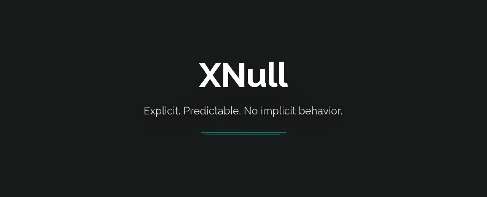

<p align="center">
  
</p>

# XNull

[English](../README.md) | [简体中文](README.zh-CN.md) | **繁體中文** | [Русский](README.ru.md) | [العربية](README.ar.md) | [Italiano](README.it.md) | [Deutsch](README.de.md)

**寫程式，別寫儀式。**

沒有生命週期標註。沒有所有權註解。沒有 `@Override`。沒有 `try/catch`。沒有 getter/setter。沒有反射。

XNull 是一門新程式語言：編譯器依規範裡的判定表，為每個物件選擇堆疊、ARC 或 GC；執行期執行這個選擇。你只寫資料和行為，不需要在型別上標註記憶體策略，也不需要猜編譯器做了什麼。

錯誤是值，多型是協定，欄位就是欄位。規範記錄每一個決定，包括每一個被拒絕的特性和理由。

```x
class Counter {
    Int n = 0

    Int add(Int v) {
        self.n = self.n + v
        return self.n
    }
}

static Int main() {
    Counter c = new Counter()
    print(c.add(2))
    return 0
}
```

| 你不再寫 | XNull 提供 |
| --- | --- |
| `Arc<Mutex<T>>`、生命週期 | 編譯器決定記憶體（堆疊 / ARC / GC） |
| `getX()` / `setX()` | 直接欄位 |
| `extends` + `@Override` | 協定 |
| `try/catch` | `Result<T,E>` + `try` |
| 反射 | 語法上不存在 |

## 為什麼是 XNull

- **記憶體管理由編譯器決定。** 原始碼不表達引用強度。編譯器依 DET-01 判定表，為每個物件選擇堆疊、ARC 或 GC；執行期負責執行判定。
- **沒有存取器模式。** 欄位是資料，行為是動詞命名的方法；getter/setter 在語法上不存在。
- **組合優先於繼承。** 類別不支援覆寫式繼承；多型只透過協定表達。
- **錯誤是值。** `Result<T,E>`、`try`、`defer`/`errdefer`；沒有例外，也沒有隱式展開。
- **沒有反射。** 原始碼與規範決定不了的東西，就不屬於語言。
- **每個決定都有紀錄。** 規範寫清 XNull 支援什麼、拒絕什麼、為什麼。中文母本 + 英文翻譯；歡迎更多語言版本。

## 快速開始

```sh
# 在倉庫根目錄執行
./src/cli/xnull run src/examples/hello.x
```

```text
hello, XNull
1 + 2 = 3
```

CLI 支援三個引擎：

```sh
```

- `mini`：新的最小編譯器。


## 倉庫結構

```text
assets/               Logo 與專案資源
docs/                 架構、語言與設計文件
README/               多語言 README
ide/                  VS Code 擴充與 Web IDE
src/                  開發樹
  cli/xnull           統一 CLI
  mini/               自舉最小編譯器
  runtime/            C 執行期原始碼與標頭檔
  xdk/                XDK 原始碼
  ffi/                raw FFI 橋（.xfb）
  toolchain/          建置與打包腳本
  examples/           可運行範例

xdk/                  XDK 交付包
  lib/xdk/            XDK 套件原始碼
  runtime/            C 執行期原始碼與標頭檔
  ffi/                raw FFI 橋
  install.sh          POSIX sh 安裝腳本
```

`src/` 是修改入口；`xdk/` 是交付副本。修改 `src/xdk/` 後，需要同步到 `xdk/lib/xdk/`。

## 開發

`src/` 是開發樹，`xdk/` 是交付副本。修改 `src/xdk/` 後，需要同步到 `xdk/lib/xdk/`。


### 安裝 XDK

```sh
cd xdk
./install.sh --prefix "$HOME/.local"
```

安裝結果：

```text
<prefix>/share/xnull/xdk
<prefix>/share/xnull/runtime
<prefix>/share/xnull/ffi
```

打包時使用 `DESTDIR`：

```sh
DESTDIR=/tmp/xdk-pkg ./install.sh --prefix /usr/local
```

## 目前狀態

| 領域 | 狀態 |
| --- | --- |
| 規範 S1—S6 | 已審定；S3 §14 有開放決策 |
| XDK 目錄 S7 | v3.0.0 草案；先落 T0 核心 |
| 工具鏈 S8 / IDE S9 | 草案 |
| 工程配置 S10 | Final v5.3.0 |
| 原生 C 工具鏈 | 目前核心場景可用 |
| 最小編譯器 | 核心語言 + 基礎類別；覆蓋範圍擴展中 |
| 端到端場景 | hello、類別、`import xdk.errors` 已通過；更多進行中 |
| 自舉 | 計畫中 |

## 明確不支援（設計如此）

| 特性 | 理由 |
| --- | --- |
| 方法覆寫 | 「實際執行的是哪個方法」必須能只看靜態型別回答；動態分派只存在於協定 |
| 存取器 / 自訂屬性 | 語法級分離：欄位是資料，行為是動詞命名的方法 |
| 反射 | 破壞「原始碼 + 規範決定一切」公理 |
| 例外 | 錯誤是值：`Result` + `try`；`throw` 僅致命終止，不展開堆疊 |

## 路線圖

1. 原生 C 後端：一個檔案編譯成 C，C 編譯成二進位，二進位跑出結果。
2. 增量補齊：由可執行場景驅動，不靠功能清單。
3. 自舉：用 XNull 重寫編譯器。

## 天使投資

XNull 正在尋求小額天使投資或非稀釋性支持，用於 12–18 個月的編譯器、自舉、執行期與 XDK 工作。目標很窄：先把現有工具鏈做正確、做快、做到可用，再擴展語言。

有興趣請聯絡 **vjsplus@163.com**，郵件主旨 `XNull Angel`。條款私下溝通。

> 本節僅供參考，不構成證券出售要約或購買要約的招攬。

## 贊助

如果 XNull 對你有幫助，歡迎小額贊助。小小心意也是支持。

微信支付（中國大陸）：


> 贊助是自願的，不構成投資，也不附帶回報承諾。

## 參與

XNull 從一個人的設計專案起步。下一階段需要編譯器工程師、執行期工程師、XDK/API 設計者、設計批評者、作者和譯者。如果你認為某個決定錯了，請帶反例來；好的反駁會變成規範修訂。

聯絡：vjsplus@163.com · [GitHub Issues](https://github.com/xnull-clang/xnull/issues)

## 授權

程式碼（`src/`、`xdk/`、`src/examples/`）採用 Apache-2.0，見 [LICENSE](../LICENSE)。規範與文件（`docs/`、`README*.md`）採用 CC BY 4.0，見 [LICENSE-docs.md](../LICENSE-docs.md)。XNull 名稱與 Logo 不在上述授權範圍內。
