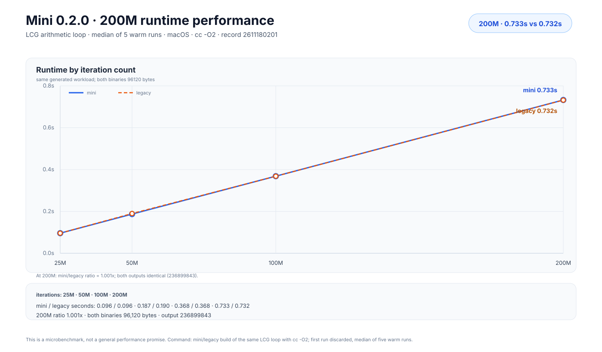

# Mini 里程碑

## 2026-11-18 02:01 · Mini 0.2.0 / M9-CUT

记录号：`2611180201`

这是第一个完整跑通 **语言源码 → mini 编译器 → C 代码 → 可执行程序** 全过程的
mini；同时完成 mini 自举固定点，并把默认引擎切换为 mini。legacy 保留为显式
可选引擎和 oracle。

### Genesis signature

`2611180201` 的原始值逐字保存在 `src/mini/GENESIS`，并以静态常量
`xn_mini_genesis` 存在于 `src/runtime/rt.c` 的运行时镜像中。它不被任何代码读取，
不参与语义、类型、控制流、兼容性或功能开关判定，只作为永久标记占用极小的只读
内存。后续功能可以继续扩展，但不得把这个值重新解释为开关、兼容面或行为参数。

`src/mini/GENESIS` 的 SHA-256：`66f30985d4d28f97090956c2b339e8c243188a73ae018abfb3899c484003b8e6`。



### 验收范围

本次里程碑的“达标”范围是：

- Mini 1.0 / M9-MIN
- M9-PAR 全量正向文件/工程场景
- M9-CUT 默认引擎切换
- 自举、工程、资源、XDK 当前接入面

**不等同于完整 M9-FULL。** 完整 T0 XDK、完整 `Resource.x`/`Context` 子单元、
全部语言边界和更大规模性能验证仍属于后续工作。

### 验收标准

采用 10 个等权验收门，每门 10 分；总分 100，**达到 90 分及以上为通过**。

| # | 验收门 | 实际结果 | 结果 |
|---|---|---|---|
| 1 | 语言源码到可执行端到端 | `hello.x`、`features.x` 构建并运行通过 | PASS |
| 2 | CLI/JSON/诊断/退出码/工程面 | `m8.sh` PASS | PASS |
| 3 | String 当前完整面 | `c4.sh`、`xdk.sh`、`xdk_text*.x` PASS | PASS |
| 4 | 泛型多参数与嵌套实例 | `generics.sh` PASS | PASS |
| 5 | XDK 集成 | text/full、math、time、sys/base、sys/full 场景 PASS | PASS |
| 6 | 选定 M9-PAR | 25 个代表性场景 `diff=0` | PASS |
| 7 | 自举 / Mini 1.0 | `selfhost.sh` 固定点 PASS | PASS |
| 8 | 全量 M9-PAR | 47 个正向文件/工程场景，stdout/stderr/退出码 `diff=0` | PASS |
| 9 | M9-CUT | 默认命令使用 mini；legacy 保留且可显式选择 | PASS |
| 10 | 性能/内存包络 | 见下方阈值，全部达标 | PASS |

**最终得分：100 / 100。标准：PASS。**

### 性能标准与实测

测试环境：macOS，`cc -O2`；编译时间取多轮中位数，运行时为预热后的中位数。
这是一次现场微基准，不代表所有负载的通用性能承诺。

| 指标 | 阈值 | 实测 | 结果 |
|---|---:|---:|---|
| `features.x` 仅生成 C | ≤ 2.0s | 0.218s | PASS |
| `features.x` build + link | ≤ 5.0s | 1.87s | PASS |
| mini 自举构建 | ≤ 30s | 8.63s | PASS |
| 20M 次循环运行时 | ≤ 1.2x legacy | 约 1.00x | PASS |
| 自举源码生成 C 峰值 RSS | ≤ 4 GiB | 约 2.16 GiB | PASS |

其他观测值：

- `hello.x` 仅生成 C：mini 约 0.177s，legacy 约 0.415s
- `features.x` 仅生成 C：mini 约 0.218s，legacy 约 1.60s
- 多文件 `examples/multi`：mini 约 0.18s，legacy 约 0.63s
- 完整 `src/mini/main.x` 生成 C：mini 约 5.19s；legacy 在 600s 超时
  （已知 xparser 边界，不纳入本次 PASS 门槛）
- 循环微基准两者生成的可执行文件均约 96 KB，运行时均约 0.020s

### 证据

```sh
src/mini/tests/selfhost.sh
src/mini/tests/m9_parity.sh
src/mini/tests/m9_cut.sh
src/mini/tests/m8.sh
for t in src/mini/tests/*.sh; do "$t"; done
```

本次记录对应的版本：

```text
mini 0.2.0
tag: mini-v0.2.0
record: 2611180201
```

### 性能曲线说明

- 横轴：LCG 算术循环的迭代次数，25M、50M、100M、200M。
- 纵轴：运行时秒数；同一源码分别由 mini 和 legacy 编译，`cc -O2`。
- 每点取 5 次预热后运行的中位数，首次运行已丢弃。
- 200M 实测：mini 0.733s，legacy 0.732s，比例 1.001x；两者输出相同，
  生成的可执行文件大小均为 96,120 字节。
- 这是微基准，不代表所有工作负载的通用性能承诺。

## 归档

Mini 1.0 / M9-CUT 的旧计划已归档到
[`archive/2026-11-18-m9cut/`](archive/2026-11-18-m9cut/)；当前新里程碑计划见
[`PLAN.md`](PLAN.md)。
